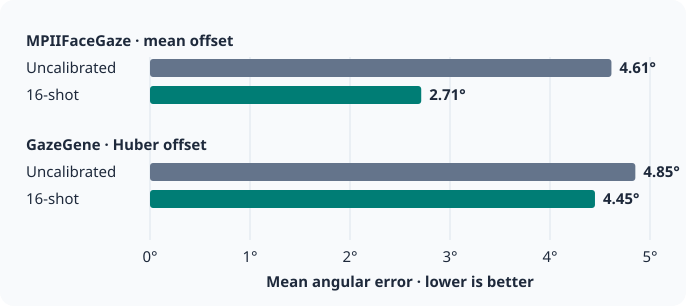

# Webcam Gaze Estimation Research

Thesis research on estimating 3D gaze direction from ordinary RGB webcams.
The project asks how much a few labeled observations from a new user can
improve a pretrained gaze estimator, and whether selecting those observations
by image quality or target coverage helps at the same calibration budget.

[Experiment ledger](docs/task1_experiment_ledger.md) ·
[Evaluation protocol](docs/research_protocol.md) ·
[Aggregate results](results/README.md) ·
[Live-webcam protocol](docs/live_webcam_calibration_protocol.md)

## Selected results

Errors are mean angular errors in degrees, averaged equally across held-out
participants. Gains compare methods on identical evaluation samples within each
protocol. Confidence intervals use participant-level bootstrap resampling.

| Experiment | Result | 95% CI and protocol |
| --- | --- | --- |
| Uncalibrated UniGaze MAE-B16 | **4.58°** | 3.94–5.21° for the mean across 15 MPIIFaceGaze leave-one-person-out folds. [Baseline report](docs/task0_lopo_baseline.md) |
| 16-shot mean offset, MPIIFaceGaze | **4.61° → 2.71°** | Paired gain 1.90° (1.31–2.51°) on a duplicate-safe evaluation subset. [Calibration report](docs/task1_mean_offset_baseline.md) |
| One-shot quality-aware selection, MPIIFaceGaze | **0.38° gain** | 0.06–0.67° versus random selection with the same mean-offset calibrator. [Selection report](docs/task1_soft_quality_selection_baseline.md) |
| 16-shot Huber offset, GazeGene | **4.85° → 4.45°** | Paired gain 0.40° (0.22–0.61°) for 10 held-out participants, with calibration fitted separately for each camera. [Independent evaluation](docs/task1_gazegene_calibration_protocol.md) |



The full-fold MPIIFaceGaze reference (4.58°) and its calibration-protocol
reference (4.61°) use different evaluation windows. MPIIFaceGaze and GazeGene
also use different models and capture protocols. The figure shows a paired
before/after comparison within each dataset.

## What the experiments show

- Simple person-specific corrections improve offline accuracy without
  retraining the gaze model. The size of the gain and the preferred correction
  depend on the dataset and the calibration budget.
- Quality-aware selection helped in the one-shot MPIIFaceGaze comparison.
  Its advantage at 16 shots was unresolved, and the quality weight was
  developed using the same participant cohort.
- Ridge-affine correction showed no resolved overall advantage over simpler
  baselines. Residual dispersion did not provide a reliable abstention score.
  Peripheral errors remain higher after calibration.

The next validation step is a consented live-webcam pilot. A stimulus manifest
and screen-geometry utilities are available. Webcam accuracy, calibration
duration, end-to-end latency and fixation detection still need direct
measurement.

## Reproduce and explore

Use Python 3.11 or newer from the repository root. This setup runs the CPU
checks and generates a calibration stimulus manifest without datasets,
checkpoints or a connected webcam.

```bash
python -m venv .venv
source .venv/bin/activate
python -m pip install -e '.[dev]' numpy
python -m pytest
python -m ruff check src scripts tests notebooks
python -m mypy src
python scripts/build_webcam_calibration_plan.py \
  --config configs/webcam_calibration_9point.toml \
  --output outputs/webcam_calibration/plan.json
```

- **Task 0 training and evaluation.** The [LOPO report](docs/task0_lopo_baseline.md)
  records fold assignments, training settings and the aggregation command.
  The [Kaggle notebook](notebooks/task0_unigaze_b16_finetune.ipynb) and
  [smoke configuration](configs/task0_unigaze_b16_smoke.toml) provide an
  entry point. The [preprocessing notebook](notebooks/task0_unigaze_b16_preprocess.ipynb)
  builds the normalized MPIIFaceGaze cache used by the folds. Full reruns
  require authorized dataset access, UniGaze/MAE weights and a GPU environment.
- **Task 1 calibration.** The [MPIIFaceGaze protocol](docs/task1_mean_offset_baseline.md#reproduction)
  gives the command for evaluating frozen predictions. The
  [GazeGene protocol](docs/task1_gazegene_calibration_protocol.md) gives its
  independent split, validation policy and artifact requirements.
- **Repository organization.** Experiment settings are in `configs/`,
  executable entry points in `scripts/` and `notebooks/`, reusable Python
  code in `src/gaze_estimation/`, and tests in `tests/`.

The public repository contains code, protocols and reviewed aggregates. Raw
images, per-frame predictions and model checkpoints require separate authorized
access. The repository has no source-code license at present. Dataset and
upstream model terms apply independently. Citation metadata is available in
[`CITATION.cff`](CITATION.cff).
